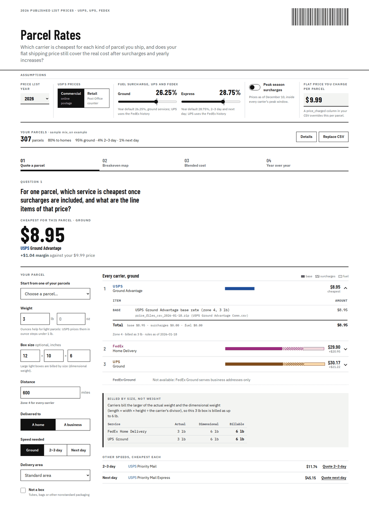
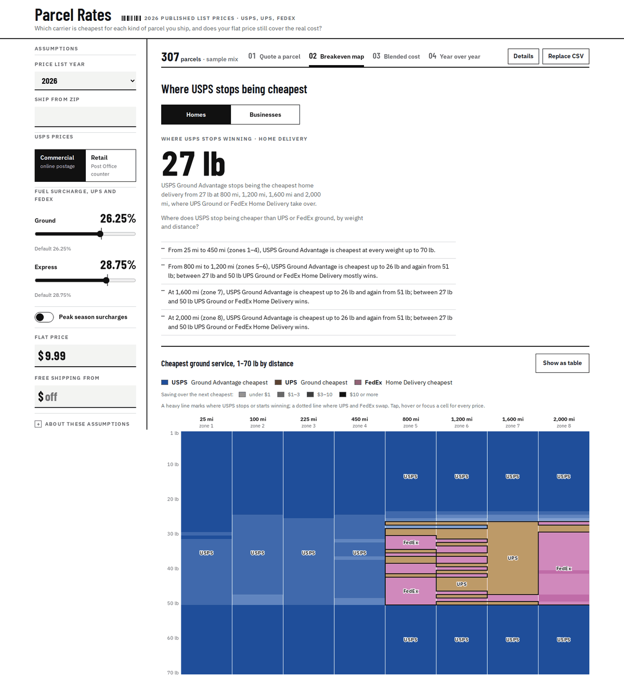
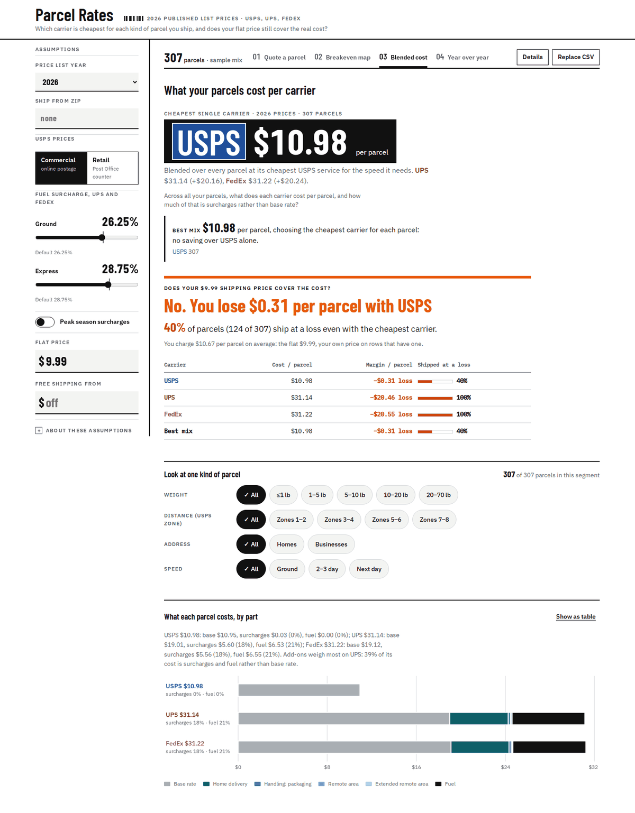
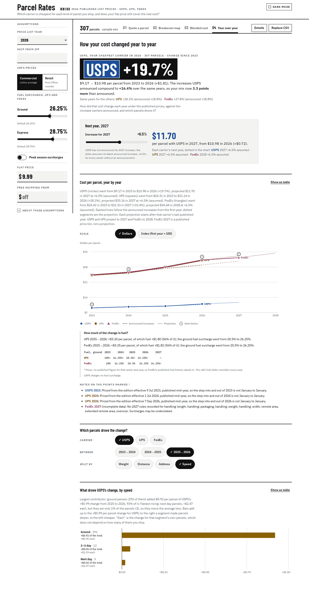
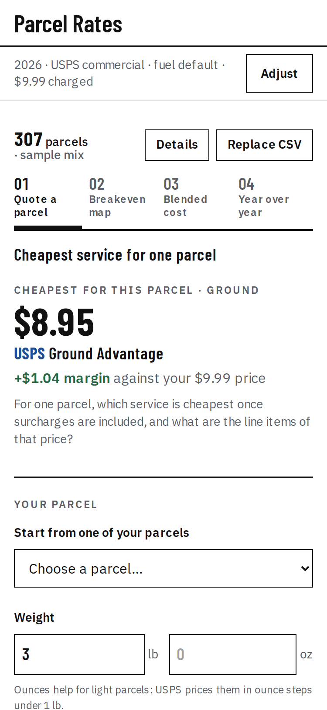
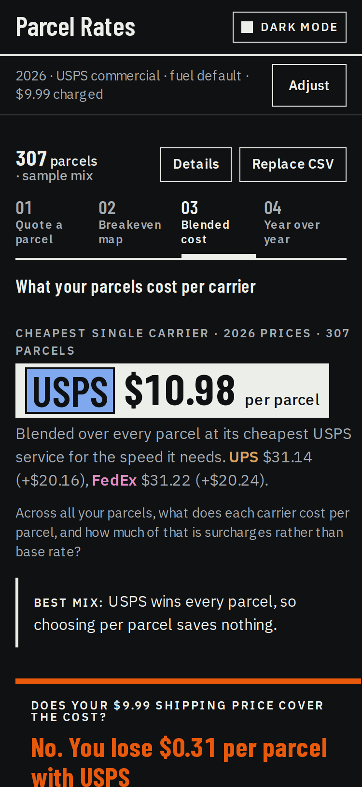

# Parcel rates: USPS, UPS and FedEx list prices for a small online shop

[](https://github.com/aivuk/parcel-rates/actions/workflows/ci.yml)

A dashboard that prices a shop's own parcels at the published prices of the
three US parcel carriers, for every year from 2023 to 2026, and shows which
carrier is cheapest, where the breakeven points are, how much of the bill is
surcharges, and how the cost moved year by year.

## Run it

Requires Docker with Compose v2. No accounts, keys or database setup.

```sh
docker compose up --build
```

Then open **http://localhost:8088**. The first build takes a minute or two.
Click "Load sample mix" to load an illustrative example parcel set, or upload your
own CSV (columns below). Stop with `Ctrl+C`, then `docker compose down`.

Only port 8088 is published. nginx serves the built dashboard and proxies
`/api/` to the backend container, which is not reachable from the host. The
rate tables are baked into the backend image; the app never fetches anything
from the carriers at run time.

The API can be tried directly at **http://localhost:8088/api/docs** (Swagger
UI; "Try it out" on `POST /api/quote` is prefilled with the example from
[docs/API.md](docs/API.md)). The schema is at `/api/openapi.json`. The docs page
loads a pinned Swagger UI from jsDelivr, so it needs a network connection; the
dashboard does not.

## What it looks like

Captured by the Playwright suite against `docker compose up` with the sample
mix and the default controls (2026 prices, USPS commercial, $9.99 charged per
parcel). The review of every capture, desktop and phone, light and dark, is in
[docs/ux-review.md](docs/ux-review.md).

**Q1. One parcel.** A 3 lb box going 600 miles to a home costs $8.95 with USPS
Ground Advantage, $1.04 under the $9.99 the shop charges; FedEx Home Delivery
and UPS Ground cost about $30, partly because they bill the box at its 6 lb
dimensional weight. Each line item cites the rate file it came from.



**Q2. Breakevens.** For home delivery USPS Ground Advantage is cheapest at every
weight up to 450 miles (zones 1-4); from 800 miles on it stops winning at 27 lb,
UPS Ground or FedEx Home Delivery take over up to 50 lb, and USPS wins again
from 51 lb.



**Q3. The whole mix.** Shipping all 307 sample parcels with USPS costs $10.98 a
parcel against $31.14 with UPS and $31.22 with FedEx, yet the shop still loses
$0.31 a parcel: 40 % of parcels (124 of 307) ship at a loss even with the
cheapest carrier.



**Q4. Year over year.** The same mix with USPS went from $9.17 in 2023 to $10.98
in 2026 (+19.7 %), 3.3 points more than the +16.4 % USPS announced over those
years; at its latest announced +6.5 % it would cost $11.70 in 2027.



**On a phone** the answer is on the first screen and the assumptions sit
behind "Adjust" (left: Q1; right: Q3 in dark mode).

<p>
  
  
</p>

## The problem and the user

The user is the owner of a small online shop that sends a few hundred to a few
thousand parcels a month, has no negotiated carrier contract, and therefore
pays published prices. The carrier is usually chosen by habit, and the flat
shipping price charged to customers was set once and not revisited.

The dashboard supports two decisions: which carrier and service to use for
each kind of parcel, and whether the flat shipping price still covers the real
cost once surcharges and yearly price increases are included.

### What it answers

| # | Question | The view |
|---|---|---|
| 1 | For one parcel (weight, size, distance, home or business, speed), which service is cheapest once surcharges are included, and what are the line items? | The cheapest total for the chosen speed comes first, with its saving over the next cheapest and the margin against your price. Below it, every carrier's cheapest service ranked, each with base rate, every surcharge (with its source page) and fuel. The form can start from one of your loaded parcels. |
| 2 | Where are the breakeven points between the Postal Service and FedEx or UPS ground, by weight and distance? | A weight by distance heatmap coloured by the cheapest ground carrier, for home or business delivery, with a heavy line where USPS stops winning and a plain-words readout of the breakeven weights; every cell's prices on hover, tap or focus, and the grid as a table. |
| 3 | For the whole parcel set, what is the blended cost per parcel with each carrier, and how much of it is surcharges? | The cheapest single carrier's cost per parcel and the "best mix" (cheapest carrier per parcel), then a yes or no on whether your shipping price covers the cost, the margin per parcel and the share shipped at a loss per carrier. A stacked chart (or table) splits the cost into base, the largest surcharges and fuel. Chips narrow everything to one kind of parcel (weight, distance, home or business, speed). |
| 4 | How did that blended cost change year by year, compared with the average increase the carriers announced, and which parcels drove it? | The cheapest carrier's change since the first year against the compounded announced increases, a year by year chart (dollars or index) with the announced path, how much of the biggest rise was fuel, the segments that drove each step, and each carrier's next year projected from the increase it announced, where it has, with a slider for the others that can also override all of them. |

Global controls: price year, USPS rate card, fuel surcharge override, peak
season toggle, the flat price charged per parcel, and an optional "free shipping
from order value" rule (parcels whose `order_value` reaches it are charged $0).

Parcel CSV columns: `weight_lb, length_in, width_in, height_in,
distance_miles, residential, speed` (`ground`, `two_three_day`, `next_day`),
where a `destination_zip` (with the "Ship from ZIP" assumption or an
`origin_zip` column) can replace `distance_miles`,
plus optional `quantity`, `price_charged`, `delivery_area`,
`nonstandard_packaging` and `order_value` (the order's value, for the
"free shipping from $X" assumption). The full schema is in
[docs/data/SCHEMA.md](docs/data/SCHEMA.md).

**The sample mix** is an illustrative home-goods shop, an example and not real
shipping data, generated by `backend/scripts/make_sample_parcels.py` with a
fixed seed: 200 rows, 307 parcels, mostly light ground parcels in boxes under
one cubic foot (about 80 % under 5 lb), about 7 % bulky boxes over one cubic
foot, 4 % two to three day and 1 % next day, about 80 % to homes, distances
weighted toward the middle zones, and a handful in delivery areas. Ground rows
leave `price_charged` empty and use the flat price control; expedited rows
carry what a shop would charge at checkout, $19.99 for two to three day and
$39.99 for next day, because real shops charge more for faster shipping. At the
default controls (2026, USPS commercial, $9.99) the mix opens near break-even:
USPS, the cheapest carrier, costs $10.98 per parcel against $10.67 charged on
average (−$0.31 per parcel), and the 40 % of parcels shipped at a loss are
mostly the bulky boxes, parcels over 5 lb and the far zones. Every row also
carries an illustrative `order_value` (about $9 per lb plus a basket of other
items); with free shipping from $75, 54 parcels ship free and the USPS margin
falls to −$2.06 per parcel.

## Data provenance

All prices come from the carriers' own published rate documents:

| Carrier | Base rates | Surcharge rules | Years |
|---|---|---|---|
| USPS | Postal Explorer CSV zips per price change; Notice 123 PDFs | Notice 123 footnotes; Domestic Mail Manual for dimensional weight | 2023 (July tables, Ground Advantage launch) to 2026 |
| UPS | Daily Rates guide PDF per year | Surcharge section of the same guide; demand surcharge PDFs | 2023 to 2026 |
| FedEx | Standard List Rates XLSX (PDF for 2023 and 2024) | Yearly surcharge-change PDFs and Service Guides | 2023 to 2026, plus 2027 as a forward year |

**Collection.** Every raw file is listed in
[data/raw/manifest.csv](data/raw/manifest.csv) with its URL, retrieval method,
SHA-256 and size, and each carrier folder has a `SOURCES.md` describing what
each file is. No step needs an agent: two commands rebuild `data/raw/` and the
manifest from a clean clone.

```sh
uv run python -m data.collect.discover --write   # find every source, write the manifest
python3 data/fetch_raw.py                        # download what is not in git, check every checksum
```

Discovery (issue #13) works from the catalogue in
[data/collect/sources.csv](data/collect/sources.csv) and the rules in
[data/collect/sources.py](data/collect/sources.py): each file's publisher URL
and the rule that picks it. UPS and FedEx block scripted downloads and replace
files in place, so 85 of the 143 files come from the Wayback Machine
(`method=wayback`). For those, discovery asks the archive's CDX index and takes
the latest good capture before the entry's cut-off. USPS price-file names are
read from the CDX listing of Postal Explorer's price-change folder (the last
final "Notice 123" zip of each price change). Both scripts are sequential and
polite: a 3 to 5 s pause with jitter, backoff on 429 and 5xx, and an
identifying User-Agent. The fetcher never re-downloads a file whose checksum
matches. `--check` (the default) compares discovery with the committed manifest
without writing anything. `--newer` also lists captures newer than each
cut-off, which is where a refresh starts. The tests replay recorded CDX answers
(`data/tests/fixtures/cdx.json.gz`), so they check offline that discovery
rebuilds the committed manifest row for row.

**What is committed.** Spreadsheets, CSV zips and small HTML snapshots (64
files, about 11 MB) are in git. The PDFs (79 files, about 137 MB) are not; run
`python3 data/fetch_raw.py` to get them. The processed tables in
`data/processed/` are committed, so the app and the backend tests never need
the raw files.

**Regenerating `data/processed/`** (needs the PDFs, so fetch first):

```sh
python3 data/fetch_raw.py                     # standard library only
uv run python -m data.pipeline.usps
uv run python -m data.pipeline.ups
uv run python -m data.pipeline.fedex
uv run python -m data.pipeline.report_changes # rewrites docs/data/RULE_CHANGES.md
```

**ZIP codes and zones** (issue #9): the USPS zone chart for every origin ZIP3
comes from the USPS Domestic Zone Chart tool (about an hour, polite and
resumable; the raw charts stay out of git and are checked against
`data/raw/usps/zones/charts.csv`), the ZIP points from the Census ZCTA
Gazetteer, and the accuracy report compares the distance estimate with the
real USPS charts and the UPS charts archived for 2026:

```sh
uv run python -m data.collect.usps_zones      # data/processed/usps/zone_chart.csv
uv run python -m data.collect.zip_points      # data/processed/zip_points.csv
uv run python -m data.collect.zone_accuracy   # docs/data/ZONE_ACCURACY.md
```

**Next-year announcements** arrive before the price lists. A watcher finds
them by rule (the USPS January price release, the dated UPS GRI table, the
FedEx rate-changes page), live first and then the latest Wayback capture,
saves each source to `data/raw` with a manifest row, and records the
percentage with its verbatim quote in `data/collect/announcements_found.csv`,
which the carrier pipelines merge:

```sh
uv run python -m data.collect.announcements --check   # report what is announced for next year
uv run python -m data.collect.announcements           # record it, then rerun data.pipeline.<carrier>
```

Base rates are parsed. Surcharges, fuel defaults, announced increases,
dimensional weight rules and the distance-to-zone bands are curated by hand
in `data/pipeline/*_rules.py`, each row with the source file, page and a
verbatim quote. Details: [docs/data/QUALITY.md](docs/data/QUALITY.md) (survey
and decisions), [docs/data/SCHEMA.md](docs/data/SCHEMA.md) (tables) and
[docs/data/RULE_CHANGES.md](docs/data/RULE_CHANGES.md) (every rule that
changed between years).

### Rate cards

| Carrier | Card | What it is |
|---|---|---|
| USPS | `commercial` (default) | Price paid with online postage or shipping software; no contract or volume needed |
| USPS | `retail` | Price paid at the Post Office counter |
| UPS | `list` | Published Daily Rates, what a shipper without a contract pays |
| FedEx | `list` | Published Standard List Rates, same meaning |

Commercial is the USPS default because a small online seller buys labels
through a marketplace or shipping software, which gives commercial prices to
anyone. Comparing UPS and FedEx list prices against USPS retail would
overstate what the shop pays the Postal Service. The retail card is one switch
away in the controls.

## Key choices

- **Stack.** Python 3.12, FastAPI and Pydantic for the rate engine and API,
  managed with `uv`. Vite, React and TypeScript for the dashboard, Recharts
  for line and bar charts and a hand-drawn SVG heatmap. Two containers behind
  one `docker compose` command. Reasons and alternatives are in
  [docs/DECISIONS.md](docs/DECISIONS.md).
- **CSV in memory, no database.** The rate tables are about 40,000 rows of
  committed CSV, loaded once at startup. Nothing to configure.
- **Curated rules with tested citations.** Surcharge prose in PDFs is too
  irregular to parse reliably, so the amounts were transcribed by hand. A test
  opens each cited page and checks that the quote, including the amount, is
  there.
- **Golden cells.** `data/tests/golden/<carrier>_<year>.csv` holds price cells
  checked by hand against the documents, including the corners of every
  table; the parsed output must match them exactly.
- **Time-varying rules.** Every rule carries `effective_from` and an inclusive
  `effective_to`, and a quote is priced on an `as_of` date. This handles
  mid-year changes such as the USPS dimensional divisor moving from 166 to 139
  on 2026-07-12, peak windows and the 2026 USPS transportation surcharge.
- **Ledger design.** The answer to each question is the largest thing in its
  section; assumptions sit in a quiet side rail. See
  [frontend/DESIGN.md](frontend/DESIGN.md).

## Known limitations

- List prices only: a shipper with a negotiated contract pays less.
- USPS zones come from the USPS zone chart when ZIP codes are given. UPS and
  FedEx do not let a script collect their zone charts, so their zones are
  estimated from the distance between the two ZIPs (or the miles typed); the
  measured accuracy is in [docs/data/ZONE_ACCURACY.md](docs/data/ZONE_ACCURACY.md).
- The UPS fuel surcharge default is a proxy taken from FedEx's published
  history (no UPS history is retrievable); the slider overrides it.
- UPS announced increases come from trade press, not from UPS itself.
- FedEx 2027 surcharges are incomplete (only the Home Delivery residential
  charge and January peak rows), so 2027 totals understate surcharges.
- Peak surcharges are a toggle that prices on December 10 of the year, not by
  ship date.
- UPS and FedEx bill a large or oversize package at a minimum of 90 lb. The
  minimum is modelled (issue #18), but actual weight is still capped at 70 lb;
  parcels whose dimensional weight is 71–150 lb are priced from the carriers'
  tables.
- Weight is capped at 70 lb, the USPS maximum. Alaska and Hawaii are out of
  scope.
- UPS 2024 and 2026 use the mid-year revision of the Daily Rates guide,
  because the December original could not be retrieved.

The same list is returned by `GET /api/meta` and shown in the app.

## What I would improve next

In rough priority order:

- Real UPS and FedEx zones through their official rating APIs (with the
  shop's own API keys), replacing the distance estimate where keys are given.
- A scheduled discovery run with `--newer`, so a new carrier document opens a
  pull request instead of waiting for someone to look.

## Local development without Docker

Needs Python 3.12 with [uv](https://docs.astral.sh/uv/) and Node 20.12 or
newer (the image uses Node 22).

```sh
# backend on http://localhost:8787
cd backend && uv run uvicorn app.main:app --reload --port 8787

# frontend on http://localhost:5173, proxies /api to localhost:8787
cd frontend && npm ci && npm run dev
```

`VITE_API_TARGET` points the dev proxy elsewhere. `http://localhost:5173/?mock=1`
runs the frontend alone on recorded API responses. The API contract is in
[docs/API.md](docs/API.md), with example payloads in `docs/api-examples/`
(regenerated by `uv run --directory backend python scripts/export_api_examples.py`).

## Tests

GitHub Actions (`.github/workflows/ci.yml`) runs lint, the data and backend
suites, the frontend tests and build on Node 20.12, and `docker compose build`
on every push and pull request. A separate job on `main` fetches the PDFs
(cached by manifest checksum) and runs the data suite with
`PARCEL_RATES_REQUIRE_RAW=1`; it reports but does not block, since the archive
can be unreachable.

| Suite | Command | What it covers |
|---|---|---|
| Data | `uv run pytest data/tests` (repository root) | Schema, parsers against golden cells, table invariants, manifest; citations whose PDF is not fetched are skipped |
| Data, full | `python3 data/fetch_raw.py && PARCEL_RATES_REQUIRE_RAW=1 uv run pytest data/tests` | Same, with every citation checked against its PDF page; a missing PDF fails |
| Backend | `cd backend && uv run pytest` | Rate engine against hand-computed quotes, rule resolution, analysis and API |
| Frontend | `cd frontend && npm ci && npm test` | Components with Testing Library and the API contract test |
| Frontend types | `cd frontend && npm run typecheck` | |
| Lint | `uvx ruff check backend data` | pyflakes, core pycodestyle, import order, bugbear (config in `pyproject.toml`) |
| End to end | `docker compose up -d --build`, then `cd frontend && npx playwright install chromium && npm run e2e` | Playwright at 1440 × 900 and 375 × 812 (touch): the four questions, global controls, URL state, CSV upload, the phone settings sheet, and axe on every view in light and dark |
| Screenshots | same stack, `cd frontend && npm run e2e:update-screens` | Rewrites `frontend/e2e/screenshots/` (every view, both sizes, light and dark), reviewed in [docs/ux-review.md](docs/ux-review.md) |

The PDFs are not in git. Three tests need them: the citation check
(`test_citations.py`), the minimum-billable-weight sentences
(`test_min_billable.py`) and one UPS parser test on a real page. On a fresh
clone they are skipped with a message telling you to run
`python3 data/fetch_raw.py`; `PARCEL_RATES_REQUIRE_RAW=1` makes a missing PDF
a failure instead. The end-to-end suite targets `http://localhost:8088`; set
`E2E_BASE_URL` to run it elsewhere, for example against the dev servers
(`E2E_BASE_URL=http://localhost:5173 npm run e2e`).

## Repository layout

```
backend/            FastAPI app (app/), tests, scripts; Dockerfile
frontend/           Vite + React dashboard; Dockerfile and nginx config
data/raw/           manifest.csv, SOURCES.md per carrier, committed raw files
data/pipeline/      parsers and curated rules that write data/processed/
data/processed/     the rate tables the app loads
data/tests/         data tests and golden cells
docs/               decisions, API contract, data docs, agent log
docker-compose.yml  the reviewer run path
```

## How this was built: the agent log

The project was built with Claude Code, one GitHub issue per task, each in its
own branch and git worktree, merged through pull requests. Every session and
subagent transcript is exported to [docs/agent-log/](docs/agent-log/) as
Markdown by a `SessionEnd` hook (`.claude/hooks/export-session.sh`), with the
prompts, the agent's responses and its tool calls. Home directory paths are
redacted. [docs/DECISIONS.md](docs/DECISIONS.md) is the running log of the
decisions those conversations led to.

To browse the logs, render them as local HTML pages (needs
[uv](https://docs.astral.sh/uv/)):

```sh
uv run tools/agent_log_html.py --open
```

This writes `build/agent-log/` (git-ignored) and opens its index: the sessions
in order, each with its prompts in a sidebar, the answers, collapsible thinking
and tool calls, the subagent transcripts, and statistics on tool use. Without
`--open` it prints the path to `index.html`. More in
[docs/agent-log/README.md](docs/agent-log/README.md).
